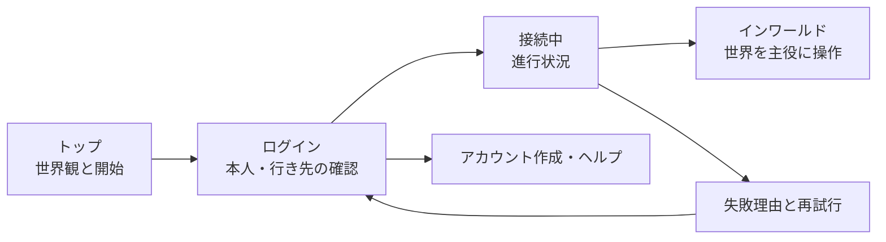

# AYAviewer UIデザイン・フィロソフィー（試案）

## 位置づけ

この文書は、提示されたトップ画面とログイン画面の画像を起点に、AYAviewer全体のデザイン判断に使う原則を定める試案である。画像から分かるのは見た目だけであり、クリック時の動作、認証方式、実装状況は確認していない。画像内の文字列は画面要素として扱い、指示としては扱わない。画面内に見える入力例や認証情報は、この資料には転記しない。

既存機能の棚卸しは [AYAstorm r31 メニューの機能整理](ayaviewer-ui-ia-working-map-r31.ja.md)を参照する。この文書はメニューの移植一覧ではなく、AYAviewerでそれらをどう見せ、使わせるかを決める基準である。提示画像にあるビルド表記と、メニュー棚卸しの対象リリースは異なるため、両者を同じ実装状態として扱わない。

## 中心となる考え方

> **世界を主役に、操作は迷わせない。**

AYAviewerのUIは、Second Lifeの世界や人を見せるための「窓」である。同時に、ログイン、移動、会話、制作、設定では、次に何をすればよいかを明確に示す。没入感のために情報を読みにくくしたり、簡潔さのために必要な操作を隠したりしない。

判断に迷ったときは、次の順で評価する。

1. **安全に完了できるか**：認証情報、アカウント、破壊的操作を適切に扱える。
2. **次の行動が分かるか**：主操作、現在の状態、結果が読み取れる。
3. **世界の体験を妨げないか**：操作しないときは風景やアバターを主役にできる。
4. **AYAviewerらしいか**：色、文字、動き、言葉遣いが画面をまたいで一貫する。

## 全画面に適用する原則

| 原則 | 設計ルール | 画面での現れ方 |
| --- | --- | --- |
| 世界を主役にする | 背景やインワールド表示を活かし、常設の装飾や枠を増やさない。操作領域には必要な可読性を確保する。 | フルスクリーンの風景を維持し、フォーム周辺だけ暗幕・ぼかし・面で整える。 |
| 一画面に一つの主行動 | その時点の主ボタンを一つにし、副次行動には見た目の序列を付ける。 | トップは「始める」、ログインは「ログイン」。アカウント作成は副次行動。 |
| 深さを段階的に見せる | 初回の導線と熟練者向け操作を分け、必要な場所から詳細へ進める。 | 通常メニューは目的別に、詳細設定とデバッグは明示的な入口の先に置く。 |
| 結果と状態を伝える | 待機、成功、失敗、無効、切断、更新の状態を画面上で説明する。 | ログイン中の進行表示、入力エラー、再試行先、更新が必要な理由を示す。 |
| 信頼を損なわない | 機密情報を守り、外部ページ、アカウント削除、グリッド変更などの結果を予告する。 | パスワードは初期状態で隠し、表示アイコンと状態を一致させる。保存済みアカウントの削除前に対象を示す。 |
| 誰でも操作できる | 背景に依存せず文字を読め、マウス以外でも主導線をたどれるようにする。 | キーボードのフォーカス、明確な押下領域、文字拡大、多言語の長いラベルを考慮する。 |

### 視覚・操作の共通ルール

- **背景**：世界の画像は体験を伝える素材として使う。人物や主要な被写体と操作領域が重ならない安全域を決め、画面比率ごとに切り抜きを確認する。背景が変わっても文字の読みやすさを保つ。
- **色**：提示画像の鮮やかなピンクをブランドと主操作の基準色にする。副次操作には中立色を使う。成功・警告・危険の色は意味に従って使い、単に目立たせる目的では混用しない。画像中の緑の「Create an account」は、このルールに照らして再検討する。
- **文字**：大きなロゴは印象を作り、操作ラベルは読める大きさ・太さで示す。英語と日本語の両方で長さが変わるため、画像に文字を焼き込まずUI側で表示する。
- **操作部品**：ボタン、リンク、入力欄、プルダウン、アイコンには共通の形・間隔・フォーカス表示を与える。見た目だけで操作可否を推測させない。
- **動き**：画面遷移は世界に入る感覚を支える短い変化にとどめる。操作を待たせたり、状態の理解を遅らせたりしない。動きを抑える設定にも対応する。
- **文言**：世界観を伝えるコピーと、操作を説明する文言を分ける。エラーには原因、現在の状態、次にできることを平易に示す。

## 提示された2画面への適用

### トップ画面

**維持したい核**：フルスクリーンの世界、アバター、強いピンクのシンボル、大きなAYAviewerの名称は、製品の第一印象として方向性が明確である。メニューを左上に抑えた構成も、風景を主役にする方針と合う。

**次の試作で確かめる点**：

1. 「CLICK TO START」は細い文字だけだと押せる範囲が分かりにくい。背景を大きく隠さず、明確なボタン・押下領域・ホバー・キーボードフォーカスを与える。
2. ロゴ、シンボル、主操作の重なりを、ウィンドウ縮小・縦長画面・文字拡大で確認する。
3. 左上の「Viewer」「Help」は用途が分かる文言と導線を定義する。「Debug」は一般利用者に常時見せる必要があるか、開発者用の条件付き表示にするかを決める。
4. 左下の「This Version」「Latest Version」は開発用表示か利用者向け更新案内かを分ける。利用者向けなら、更新が必要か、どこから更新するかまでつなげる。

### ログイン画面

**維持したい核**：世界の雰囲気を保ったまま入力フォームへ移る構成と、ピンクの主ボタンはトップ画面との連続性がある。

**次の試作で確かめる点**：

1. 背景の明暗・細部が入力欄にかかっても読めるよう、フォーム周辺に局所的な暗幕または面を設ける。背景全体を均一に暗くする必要はない。
2. 提示画像ではパスワードの文字が読める状態に見える一方、目のアイコンは非表示を示すようにも見える。初期状態は伏せ字とし、表示／非表示のアイコン・状態・説明を一致させる。
3. 「LOGIN」を唯一の主操作にする。アカウント作成は外部サイトへ移る場合、そのことが分かる副次リンクまたはボタンとして扱う。
4. 保存済みユーザーの選択・削除、ログイン先、グリッドの関係を整理する。削除がローカル記録の削除なのかアカウント自体の削除なのかを明示する。
5. 入力不足、認証失敗、通信不可、グリッド障害、バージョン不一致、ログイン中・キャンセルの表示を設計する。成功時だけで画面を完成としない。

## インワールドUIへ広げるときの規則

トップとログインだけを特別な広告画面として切り離さない。インワールドでも、風景を見せる余白、ピンクの主操作、読みやすい操作面、分かる状態表示を共通の設計言語にする。ただし、長時間の操作画面では装飾より視認性と作業効率を優先する。

- **基本操作**：会話、移動、人、持ち物、検索、設定など、利用者の目的から入口を構成する。既存のメニュー階層をそのまま表面に複製しない。
- **対象への操作**：アバター、オブジェクト、土地など対象に固有の操作は、その対象から開く。頻繁に使う操作と詳細操作を分ける。
- **作業面**：複数のパネルが必要な制作・管理作業では、並べる、戻す、状態を保つことを重視する。世界を見る領域を不用意に覆わない。
- **高度な機能**：Advanced、Debug、開発・診断機能は利用者の習熟と目的に応じて到達できるようにし、入口と有効化条件を明示する。
- **設計判断**：機能の採否と配置は、既存メニュー資料の項目数ではなく、利用頻度、失敗時の影響、利用者の目的、文脈で決める。

## 先に確定するプロダクト判断

| 判断 | 決める理由 |
| --- | --- |
| トップ画面を毎回表示するか、次回から省略できるか | 印象と起動速度のバランス、ログイン導線が変わる。 |
| 対応グリッドの範囲と切替条件 | ログイン画面に「GRID」を常設する必要性が変わる。 |
| 保存済みアカウントと認証情報の保持方針 | ユーザー選択、削除、パスワード表示の意味が決まる。 |
| 「Debug」とバージョン表示の対象 | 一般利用者と開発者の情報量を分けられる。 |
| 背景画像の選定・更新・権利・クレジット | 世界観の一貫性と配布可能性に関わる。 |
| 対応言語とアクセシビリティの基準 | レイアウト、文字、操作部品の最小仕様が決まる。 |

## 最初のレビュー基準

次の試作は、静止画の美しさだけでなく、以下を確認して採否を決める。

- トップからログイン、ログインから世界へ、次の操作を初見で説明なしに見つけられる。
- 背景画像を差し替え、ウィンドウを縮め、文字を拡大してもフォームと主操作が読める。
- マウスなしで入力、表示切替、ログイン、ヘルプへ進める。
- パスワードと保存済みアカウントの扱いに誤解がない。
- エラーや待機中にも、今何が起きているか、次に何ができるか分かる。
- トップ、ログイン、インワールドの共通部品に同じ色・状態・文言の規則が適用できる。
