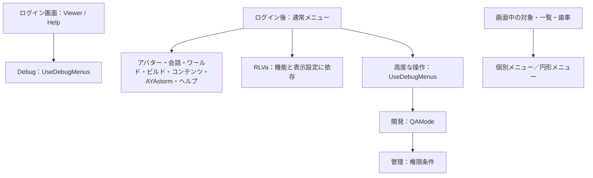
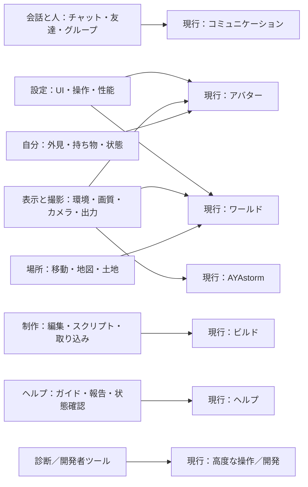

# AYAviewer 新UI設計用：AYAstorm r31 メニューの機能整理

## この資料の位置づけ

基準は公開リリース `v7.2.4-ayastorm-r31-bugfix-2`（`214054a5`）。[全階層](ayaviewer-ui-menu-tree-r31.ja.md)は「現行の場所」、[CSV](ayaviewer-ui-menu-items-r31.csv)は項目単位の原票。この文書は、それらを **ユーザーが何をしたいか** で整理し直した設計作業台である。[メニュー探索図](ayaviewer-ui-menu-explorer-r31.html)では原票を画面上で辿れる。

AYAviewer全体の判断基準は [UIデザイン・フィロソフィー](ayaviewer-ui-design-philosophy.ja.md)を参照する。

以下で「現行」は固定タグの XML／クリック処理から確認したこと、「AYAviewer の整理先」は新UIの**検討案**である。CSV の `draft_bucket` は現行経路・ファイル名から機械的に付けた仮分類で、機能の採否や移行先の確定ではない。ビューワー実行時の全状態を確認した結果でもない。

## 1. 現行の入口と到達条件

| 入口 | 操作項目数¹ | 到達条件 | UI設計での扱い |
| --- | ---: | --- | --- |
| アバター | 67 | 通常の上部メニュー | 自分、着用、移動、撮影、設定が混在 |
| コミュニケーション | 26 | 通常の上部メニュー | 会話、人、グループ、外部共有 |
| ワールド | 55 | 通常の上部メニュー | 場所、土地、表示、環境、撮影が混在 |
| ビルド | 76 | 通常の上部メニュー | 編集、スクリプト、アップロード |
| コンテンツ | 12 | 通常の上部メニュー | 検索、マーケット、外部リンク |
| AYAstorm | 1 | 通常の上部メニュー | AYAstorm Controls を開く |
| ヘルプ | 16 | 通常の上部メニュー | 支援、診断への一部入口 |
| RLVa | 20 | RLVa 有効かつ上部表示設定時 | Advanced 内への移動も可能 |
| 高度な操作 | 73 | `UseDebugMenus` 有効時 | ユーザー機能と診断機能が混在 |
| 開発 | 221 | `QAMode` 有効時 | 開発・検証用の深い階層 |
| 管理 | 12 | 管理権限など | 通常ユーザー向け情報設計から分離 |
| 旧 Admin 定義 | 21 | XML 上は非表示 | 通常導線として移植しない |

¹ `menu_item_call`／`menu_item_check`／`pie_slice` の **XML 定義数**。クリック可能な状態の実測数ではない。通常画面 `menu_viewer.xml` の操作項目は計600、構造ノードは674。ログイン画面は別の `menu_login.xml`。その他の `menu_*.xml` は154定義（うち円形メニュー7定義）あるが、各画面での起動可否は実機照合が必要。

現行のクリック経路は「ワールド → 表示 → 高度な操作メニューを表示する」→「高度な操作 → 開発メニューを表示」。ログイン画面の Debug は `UseDebugMenus` で表示される。管理メニューは管理権限、または Advanced と管理 override の条件に依存する。RLVa は有効時に上部メニューと Advanced 内の埋め込みメニューを切り替える。これらは [`show_debug_menus()`](https://github.com/mayatonton/phoenix-firestorm/blob/v7.2.4-ayastorm-r31-bugfix-2/indra/newview/llviewermenu.cpp#L7654-L7690) と [`rlvMenuToggleVisible()`](https://github.com/mayatonton/phoenix-firestorm/blob/v7.2.4-ayastorm-r31-bugfix-2/indra/newview/rlvcommon.cpp#L804-L830) に基づく。

## 2. 使う目的から見た現行経路

| 目的 | 現行の代表経路 | クリック処理から分かる到達先・動作 | AYAviewer の整理先（案） |
| --- | --- | --- | --- |
| 持ち物を見る | アバター → インベントリ | `inventory` を開閉 | 自分／持ち物 |
| 着用を変える | アバター → アウトフィット、アバター → 脱ぐ | 外見画面、種類別の脱衣 | 自分／外見・着用 |
| アバターを復旧する | アバター → アバターの状態 → リベーク・装着物更新・スケルトンリセット | 個別の修復操作 | 自分／状態と復旧。診断にも参照導線 |
| 移動する | アバター → 移動、ワールド → ホームにテレポート | 移動切替・テレポート | 移動と場所 |
| 行き先を探す | ワールド → 場所・行き先・ワールドマップ・テレポート履歴 | 対応画面を開く | 場所と移動 |
| 土地を調べる | ワールド → 土地情報・リージョン／不動産 | `about_land`・`region_info` | 場所／土地情報 |
| 会話する | コミュニケーション → チャット・会話・近くのボイス | チャット・会話・ボイス画面を開く | 会話 |
| 人やグループを探す | コミュニケーション → フレンド・コンタクト・グループ・ブロックリスト | 人物関連画面／タブを開く | 人とグループ |
| オブジェクトを編集する | ビルド → ビルドツール・要素選択・オブジェクト | 編集ツール、選択操作 | 制作／オブジェクト |
| スクリプトを管理する | ビルド → スクリプト → 警告・再コンパイル・リセット・開始／停止 | 選択対象のスクリプト操作 | 制作／スクリプト |
| 素材をアップロードする | ビルド → アップロード → 画像・音・アニメ・モデル・マテリアル・一括 | 種類別アップロード | 制作／取り込み。費用表示を保持 |
| 静止画を撮る | アバター → スナップショット／360度スナップショット | `snapshot`・`360capture` | 撮影／出力 |
| 撮影条件を整える | ワールド → フォトとビデオ → フォトツール・カメラツール・DoF | 撮影画面と DoF 設定 | 撮影／カメラ |
| 風景を変える | ワールド → 自然環境 → 時刻・共有環境・個人設定 | 環境プリセット・編集 | 表示と環境 |
| AYAstorm Viewを調整する | AYAstorm → AYAstorm Controls... | `aya_cinematic` 画面を開く | 表示と環境／画質。名称は再検討 |
| 表示負荷を下げる | ワールド → グラフィック性能の最適化… | `performance` 画面を開く | 表示と環境／パフォーマンス |
| トラブルを診る | 高度な操作 → パフォーマンスツール、デバッグ設定 | 統計・遅延・設定画面を開く | 診断 |
| 開発用の計測をする | 開発 → コンソール・情報を表示・描画・ネットワーク・キャッシュ・UI | 開発用表示／操作 | 開発者ツール |
| 支援を受ける | ヘルプ → ガイド・サポート・バグ報告 | URL または支援画面 | ヘルプ |

同じ目的が複数の上部メニューに散るものを先に示した。「撮影」はアバターとワールド、「表示品質」はワールド・AYAstorm・高度な操作、「復旧」はアバターと高度な操作にまたがる。新UIで入口を決めるときは、機能の所有場所と、その場で使える近道を分けて設計する必要がある。

## 3. 画面・対象に付くメニュー

上部メニューだけでは操作体系を再現できない。以下は固定タグに存在するメニュー定義を、**ファイル名による画面領域の推定**でまとめた。画面からの起動と有効条件は未照合。

| 現行の対象領域 | 主な定義ファイル | 新UIで決めること |
| --- | --- | --- |
| 自分・他人のアバター・装着物 | `menu_avatar_*.xml`、`menu_attachment_*.xml`、`menu_pie_avatar_*.xml`、`menu_pie_attachment_*.xml` | 自分／他人と通常／右クリック／円形の操作差 |
| 持ち物・アウトフィット・着用 | `menu_inventory*.xml`、`menu_gallery_inventory.xml`、`menu_outfit*.xml`、`menu_wearing*.xml` | 一覧・ギャラリー・着用中の共通操作と固有操作 |
| 会話・人物 | `menu_conversation*.xml`、`menu_people*.xml`、`menu_fs_radar*.xml`、`menu_participant*.xml` | 相手・会話・近くの人に対する操作をどこで共有するか |
| 場所・地図・土地 | `menu_mini_map.xml`、`menu_land*.xml`、`menu_places*.xml`、`menu_teleport_history*.xml` | 現在地と保存場所、地図上の対象の違い |
| オブジェクト・制作 | `menu_object*.xml`、`menu_pie_object.xml`、`menu_copy_paste_*.xml` | 選択対象の状態、権限、編集ツールとの関係 |
| 画面操作・表示 | `menu_toolbars*.xml`、`menu_navbar.xml`、`menu_hide_navbar.xml`、`menu_topinfobar.xml` | 常時表示、カスタマイズ、隠した後の復帰経路 |
| URL・SLURL・埋め込みメディア | `menu_url_*.xml`、`menu_slurl.xml`、`menu_media_ctrl.xml` | 外部／ビューア内／テレポートの遷移区別 |

各ファイルの全項目と分岐は[探索図](ayaviewer-ui-menu-explorer-r31.html)と[全階層](ayaviewer-ui-menu-tree-r31.ja.md)を参照。[コード参照表](ayaviewer-ui-menu-code-references-r31.csv)には、メニューファイル名を直接参照する112箇所を記録した。呼び出し元を調べる入口になるが、参照がないファイルも間接的に使われ得る。ファイルがあることだけでは、特定の画面で常にそのメニューを開けるとは言えない。

## 4. 重複・分散・移行時の注意

| 現行の事実 | 設計上の論点 |
| --- | --- |
| 「テクスチャをリベークする」「装着物をリフレッシュ」はアバターの状態と高度な操作に同じクリック処理で存在する。 | 一次導線を状態と復旧へ寄せるか、Advanced を近道として残すか。 |
| 「グラフィック性能の最適化…」はワールドと高度な操作の双方から `performance` を開く。 | 表示設定と診断を分け、同じ画面への別経路だと分かるようにする。 |
| スナップショットはアバター、フォト／カメラツールと DoF はワールド、AYAstorm Controls は独立メニュー。 | 撮影中の作業フローを一つのワークスペースにできるか。 |
| 「遅延メーター」はアバターの状態と高度な操作の双方にある。 | ユーザー向け性能表示と開発向け計測の境界を決める。 |
| `Developer` は221項目を含み、描画・キャッシュ・ネットワーク・UI・アバター試験を横断する。 | 一般向けナビゲーションに展開せず、診断ツールの索引と権限を設ける。 |
| XML の `Deprecated` Admin は現行 Admin と同じ表示名だが別ノード。 | 名前だけで移行対象をマージしない。 |
| ログイン画面にも Viewer／Help／Debug がある。 | ログイン前に必要な設定・支援と、ログイン後専用の操作を分離する。 |
| 「Firestorm」名のサポートや外部コンテンツリンクが Content／Help に残る。 | AYAviewer のブランド・サポート先を決めてから置換／廃止を判断する。 |

クリック処理が同じでも、対象や文脈で意味が違う場合がある。CSV の `on_click` 一致は統合候補の発見に使い、統合の確定条件にはしない。例として `Agent.toggleFlying` は「飛ぶ」と「着地する」で共有される。

## 5. AYAviewer の情報設計たたき台

これは移行先を議論するための**仮置き**。上記の全項目を自動的に新メニューへ移す提案ではない。

設計上の原則候補は次の通り。

1. **操作対象に結びつくコマンドはその対象の画面にも置く。** 持ち物・人物・オブジェクトは、上部メニューだけでなく各一覧と右クリックからの経路を保つ。
2. **「開く」「即時実行」「切替」「外部へ移動」を視覚的に区別する。** 元XMLの `menu_item_call`／`menu_item_check` と `on_click` を移行台帳の基礎にする。
3. **不可逆または共有状態に影響する操作は別扱いにする。** 削除、購入、管理者操作、スクリプト削除等は確認と権限条件を個別に検討する。現行メニュー上の存在だけで実行可能とはみなさない。
4. **診断は残しつつ一般導線を埋めない。** Advanced と Developer の項目を一括で「設定」に移さず、利用者向け復旧と開発者向け検証を仕分ける。
5. **ブランド名・URL・機能名を分けて棚卸しする。** Firestorm 由来の項目、AYAstorm 固有機能、汎用の Second Life 操作を混同しない。

## 6. 次に実画面で確かめること

新UIの配置決定前に、リリースバイナリで少なくとも次を照合する。

| 確認場面 | 確認する理由 |
| --- | --- |
| ログイン前／後、通常／Advanced／Developer | XML 初期値と実行時の出現条件が異なるため |
| RLVa 無効／有効・上部表示／埋め込み表示 | 同じ機能が移動し、階層が変わるため |
| 自分／他人／装着物／土地／オブジェクト、選択数と権限差 | コンテキストメニューの有効・非表示条件が変わるため |
| 日本語／英語 UI | 日本語オーバーレイに未訳項目や英語との差があるため |
| macOS での実際の画面遷移 | XML の静的定義だけではクリック結果を保証できないため |

また、コードが実行時に挿入する装着先などの可変項目や、XML にないメニューは静的資料の範囲外。探索図で項目を見つけられない場合は、その画面の生成コードを確認する。
