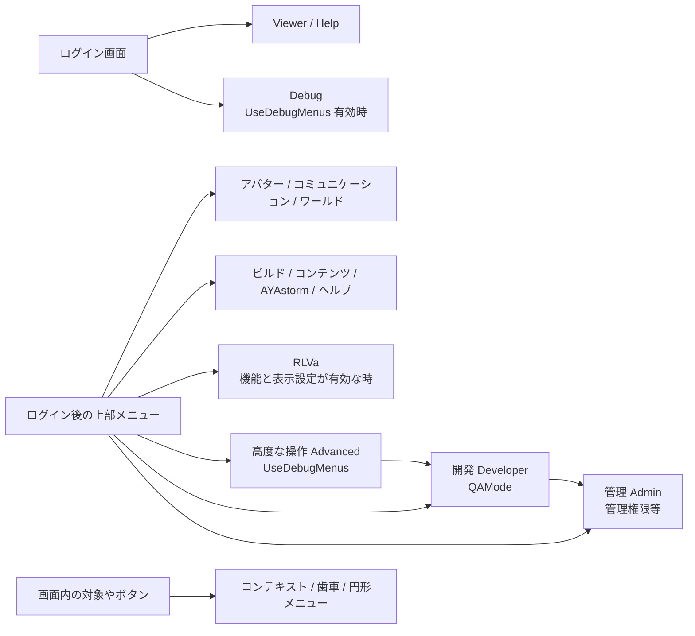

# AYAviewer UI 設計のための AYAstorm リリース版メニューマップ

**UI設計の検討は [機能整理・現行経路と再配置の対応表](ayaviewer-ui-ia-working-map-r31.ja.md) から始める。** このページは資料全体の入口と表示条件の要約である。個別メニューは [探索図](ayaviewer-ui-menu-explorer-r31.html) で辿れる。

## 基準と読み方

2026-09-23 に[AYAstorm 公開リリース一覧](https://github.com/mayatonton/phoenix-firestorm/releases)で Latest と表示された **AYAstorm r31-bugfix-2** を基準にした。固定タグは `v7.2.4-ayastorm-r31-bugfix-2`、コミットは `214054a5a71619c83a9802d37a185f6bc44c6908`。開発ブランチのメニュー変更は混ぜていない。

主な根拠は同タグの [通常画面メニュー定義](https://github.com/mayatonton/phoenix-firestorm/blob/v7.2.4-ayastorm-r31-bugfix-2/indra/newview/skins/default/xui/en/menu_viewer.xml)、[ログイン画面メニュー定義](https://github.com/mayatonton/phoenix-firestorm/blob/v7.2.4-ayastorm-r31-bugfix-2/indra/newview/skins/default/xui/en/menu_login.xml)、各 `menu_*.xml` と日本語 `xui/ja`、および [表示制御コード](https://github.com/mayatonton/phoenix-firestorm/blob/v7.2.4-ayastorm-r31-bugfix-2/indra/newview/llviewermenu.cpp) である。

- [全階層の資料](ayaviewer-ui-menu-tree-r31.ja.md)：通常画面、ログイン画面、その他のクリック／右クリックメニュー 156 定義を列挙。
- [検索・再分類用 CSV](ayaviewer-ui-menu-items-r31.csv)：2,719 ノードの日本語／英語経路、仮の機能分類、XML 名、初期表示、条件コールバック、クリック処理、ショートカット、定義元を収録。
- [クリック起点を調べるためのコード参照 CSV](ayaviewer-ui-menu-code-references-r31.csv)：メニューファイル名を直接参照するコード箇所。直接参照がないことは利用不能の証明ではない。
- [抽出スクリプト](../../scripts/generate_ayastorm_menu_reference.py)：固定タグから階層、CSV、探索図を再生成する。

これは **XML と表示制御コードに基づく静的な現状図**。実機で各メニューを開いて全項目の表示とクリックを検証した記録ではない。CSV の `xml_visible` は XML 上の初期値、`on_visible`／`on_enable` は条件関数の存在を示す。空欄は常時表示・常時操作可の証明ではない。右クリックメニューの起動場所はファイル名から推定できるが、個々の起動経路は別途 UI 上で照合する。

## 入口の構造

通常画面の上部メニューは [`menu_viewer.xml`](ayaviewer-ui-menu-tree-r31.ja.md#menu_viewerxml) のツリーで辿れる。初期表示の主要入口と直下のサブメニューは次の通り。

| 上部メニュー | 主な直下の階層・役割 | 初期状態 |
| --- | --- | --- |
| アバター | 脱ぐ、移動、アバターの状態、装着、プロフィール、インベントリ、設定 | 表示 |
| コミュニケーション | ログイン状態、会話、フレンド、グループ | 表示 |
| ワールド | 表示、自然環境、フォトとビデオ、アバター表示、ナビゲーション | 表示 |
| ビルド | ツール、要素選択、オブジェクト、スクリプト、経路探索、オプション、アップロード | 表示 |
| コンテンツ | コンテンツ関連の入口 | 表示 |
| AYAstorm | AYAstorm Controls...（AYAstorm View の操作画面） | 表示 |
| ヘルプ | ガイド、サポート、About など | 表示 |
| RLVa | 機能項目、デバッグ | XML は表示。実行時に切替 |
| 高度な操作 / Advanced | パフォーマンス、表示、レンダリング種別・機能、RLVa、ショートカット | 初期非表示 |
| 開発 / Developer | コンソール、描画、ネットワーク、キャッシュ、ワールド、UI、XUI、アバター、ログなど | 初期非表示 |
| 管理 / Admin | オブジェクト、区画、リージョンなど | 初期非表示・権限依存 |

末尾に `name="Deprecated"` の旧 Admin 定義も残っている。通常の Admin と表示名が同じでも別ノードであり、UI 移行の通常導線には含めない。

## 高度な操作・デバッグ系の表示経路

| 操作 | 現行のクリック経路・条件 |
| --- | --- |
| 高度な操作を表示 | ワールド → 表示 → 高度な操作メニューを表示する。 `UseDebugMenus` は初期値 0。 |
| 開発メニューを表示 | 高度な操作 → 開発メニューを表示（Ctrl+Alt+Q）。`QAMode` は初期値 0。環境設定の高度な設定にも表示スイッチがある。 |
| デバッグ設定 | 高度な操作 → デバッグ設定を表示。開発メニュー内にはコンソール、ログ、描画・UI 診断などの階層がある。 |
| ログイン画面の Debug | `UseDebugMenus` が有効な時に表示。ログイン画面側に「デバッグメニューを表示する」がある。 |
| RLVa | RLVa 有効時、設定 `RLVaTopLevelMenu` により上部メニューか高度な操作内の埋め込みメニューへ移動する。初期値は上部表示。 |
| Admin | 管理権限、または Advanced 有効かつ管理 override の条件で表示される。一般利用者の通常導線ではない。 |

上記条件は [`show_debug_menus()`](https://github.com/mayatonton/phoenix-firestorm/blob/v7.2.4-ayastorm-r31-bugfix-2/indra/newview/llviewermenu.cpp#L7654-L7690) と [`rlvMenuToggleVisible()`](https://github.com/mayatonton/phoenix-firestorm/blob/v7.2.4-ayastorm-r31-bugfix-2/indra/newview/rlvcommon.cpp#L804-L830) を基準に記した。メニュー項目自体の有効／無効、グリッド差、オブジェクト選択時の変化は全階層資料と CSV の各行を参照。

## AYAviewer 側で整理する単位

新 UI では、まず「常用操作」「制作・撮影」「設定」「診断・開発」「管理権限」を別の入口として検討できる。特に現行ではデバッグに関係する入口が、ログイン画面の Debug、ワールド内の Advanced 表示スイッチ、Advanced の Debug Settings、Developer、RLVa Debug に分散している。現行の表示名と操作経路は [全階層](ayaviewer-ui-menu-tree-r31.ja.md) に残し、再配置案を作る時は [CSV](ayaviewer-ui-menu-items-r31.csv) の `path_name`、`on_click`、`node_index` で同名項目を区別する。

動的生成される装着先やサーバー由来の値、XML 以外のコードから作るメニューはこの静的列挙だけでは確定しない。AYAviewer の画面構成を固める段階では、リリースバイナリの実機画面で、ログイン前後・RLVa 設定・権限・対象選択ごとに突き合わせる。
